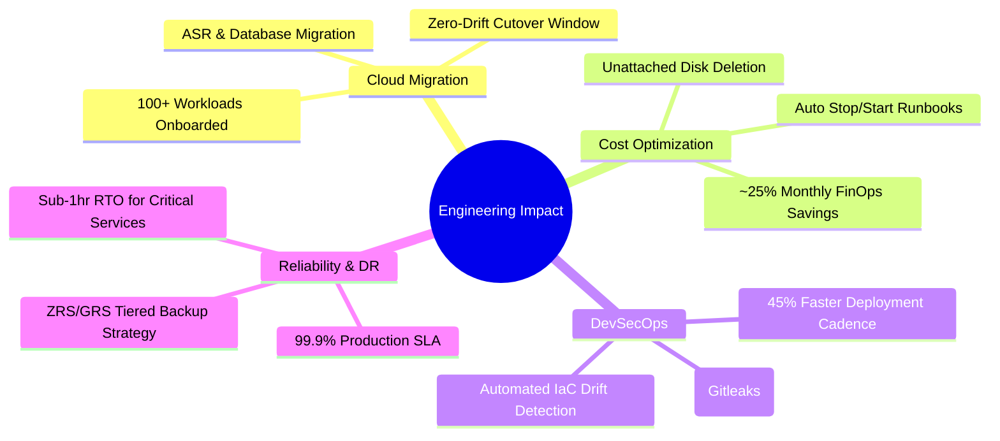

<p align="center">
  
</p>

<p align="center">
  <a href="http://www.linkedin.com/in/shekharxt"></a>
  <a href="https://github.com/Shekharxt"></a>
  
  
</p>

---

### 👨‍💻 About Me

I am a **DevOps & Cloud Infrastructure Engineer** with **3.5+ years of hands-on experience** architecting, automating, and maintaining enterprise-scale cloud workloads on **Microsoft Azure**. 

My core focus centers on building secure, scalable, and resilient foundations: from **Cloud Adoption Framework (CAF) Enterprise Landing Zones** and **modular Infrastructure as Code (Terraform)** to zero-trust **Hub-and-Spoke network topologies**, automated **DevSecOps CI/CD pipelines**, and multi-tier **100+ application cloud migrations**.

```
☁️  Cloud Architecture  │ Microsoft Azure • CAF Landing Zones • Multi-Subscription Topology
🛠️  Infrastructure-as-Code │ Terraform (Modules, Remote State, Drift Detection) • OpenTofu • Bicep
🛡️  DevSecOps & CI/CD   │ Azure DevOps • GitHub Actions • Security Gates (Gitleaks, Trivy, Checkov)
☸️  Containers & SRE    │ Kubernetes (AKS) • Docker • Helm • Azure Monitor • Prometheus & Grafana
💰  FinOps & Governance │ Cost Optimization • Idle Waste Remediation • Reserved Instances • Azure Policy
```

---

## 🏛️ Featured Architecture Blueprints

Explore production-tested engineering blueprints documented directly inside this repository:

| Blueprint | Key Focus Areas | Architecture Link |
| :--- | :--- | :--- |
| **🏢 Azure Enterprise Landing Zone** | Management Groups, Hub-Spoke, Centralized Egress, Azure Firewall, UDRs, Private Endpoints, RBAC & Azure Policy Initiatives. | [View Blueprint](https://github.com/Shekharxt/Shekharxt/blob/main/architecture-blueprints/01-azure-enterprise-landing-zone.md) |
| **🛡️ DevSecOps CI/CD Standards** | Trunk-Based Branching, Reusable YAML Templates, Secret Scanning (Gitleaks), Infracost, SAST, Automated Rollbacks & Drift Detection. | [View Blueprint](https://github.com/Shekharxt/Shekharxt/blob/main/architecture-blueprints/02-devsecops-pipeline-standard.md) |
| **💰 FinOps & Waste Elimination** | Resource Rightsizing, Orphaned Disk Automation, Scheduled Start/Stop Runbooks, Log Analytics Ingestion Tuning, Reserved Instances. | [View Blueprint](https://github.com/Shekharxt/Shekharxt/blob/main/architecture-blueprints/03-finops-and-cost-optimization.md) |
| **🚀 100+ App Cloud Migration Playbook** | 6Rs Wave Planning, On-Premises CIDR Assessment, Pre/Cutover/Hypercare Checklists, Azure Site Recovery, Minimal Downtime. | [View Blueprint](https://github.com/Shekharxt/Shekharxt/blob/main/architecture-blueprints/04-cloud-migration-framework.md) |

---

## 🛠️ Technical Competencies

<div align="center">

| Domain | Technologies & Methodologies |
| :--- | :--- |
| **Cloud Platforms** |     |
| **Infrastructure as Code** |      |
| **CI/CD & DevSecOps** |      |
| **Containers & Orchestration** |     |
| **Networking & Security** |      |
| **Observability & SRE** |      |
| **Scripting & Automation** |      |

</div>

---

## 📈 Enterprise Production Impact



- 🚀 **100+ Application Modernization**: Designed infrastructure readiness, CIDR assessments, and wave migration execution across Dev, UAT, and Production.
- ⏱️ **45% Faster Release Cycles**: Engineered modular YAML pipeline templates in Azure DevOps with standardized linting, automated testing, and rollback safeguards.
- 🛡️ **Zero-Trust Security Baseline**: Implemented CIS benchmark security policies, enforcing RBAC least-privilege, private endpoints, and disabling public access on data storage.
- 💰 **~25% Cloud Cost Optimization**: Identified and purged idle resources, rightsized over-provisioned VMs, optimized Log Analytics retention, and recommended Reserved Instances.

---

## 🏗️ Core Architectural Domains

<details>
<summary><b>1. Enterprise Azure Landing Zone & Governance (CAF)</b></summary>

- **Tenant Root & Management Groups**: Structured segregation into Platform (Identity, Connectivity, Management), Workloads (Non-Prod, Prod), Sandboxes, and Decommissioned.
- **Enterprise Governance**: Standardized tagging, allowed Azure regions, audit of unencrypted storage accounts, and denial of public IPs on network interfaces.
- **Subscription Lifecycle**: Automated vending of new workload subscriptions with baseline network peering and security boundaries pre-configured.
</details>

<details>
<summary><b>2. Hub-and-Spoke Networking & Perimeter Security</b></summary>

- **Centralized Egress & Inspection**: Hub VNet containing Azure Firewall with custom UDRs forcing default outbound traffic (`0.0.0.0/0`) through central inspection.
- **Micro-Segmentation**: Strict Network Security Groups (NSGs) restricting inter-subnet traffic between Web, App, and Database tiers.
- **Private Link & Private DNS**: Fully resolved private communication for Azure SQL, Key Vault, and Storage Accounts without traversing the public internet.
</details>

<details>
<summary><b>3. Terraform & Infrastructure as Code Best Practices</b></summary>

- **Remote State Security**: Azure Blob Storage backend with state-locking, versioning, GRS redundancy, and restrictive Azure RBAC permissions.
- **Reusable Module Architecture**: DRY modular architecture with parameterized variables, validation rules, and comprehensive outputs.
- **Pipeline Shift-Left**: Pull request validation with `tflint`, `checkov`, and `infracost` cost breakdowns prior to production approval.
- **Continuous Drift Detection**: Daily scheduled pipeline runs to detect and flag manual portal modifications.
</details>

<details>
<summary><b>4. DevSecOps CI/CD Automation</b></summary>

- **Trunk-Based Development**: Short-lived feature branches, mandatory branch policies, and required peer approvals with Code Owners.
- **Multi-Stage Delivery**: Automated transitions through Lint → Security Scan → Build → Dev → UAT → Production Approval Gate → Automated Health Check.
- **Security Guardrails**: Integration of Gitleaks (secret detection), Trivy (container image vulnerability scanning), and SonarQube (code quality).
</details>

<details>
<summary><b>5. FinOps & SRE Observability</b></summary>

- **Telemetry & Central Log Analytics**: Unified workspace with custom KQL queries, dynamic alert rules, and action group notifications to Slack/Teams.
- **High Availability & DR**: Multi-zone deployments (ZRS), Virtual Machine Scale Sets (VMSS), and automated backup retention policies tailored to RTO/RPO requirements.
- **Automated Cost Governance**: Logic App and Azure Automation schedules for powering down non-production workloads during off-peak hours.
</details>

---

## 📊 GitHub Analytics

<p align="center">
  
  
</p>

<p align="center">
  
</p>

---

## 🎯 Professional Roadmap & Certifications

- [x] **AZ-104**: Microsoft Certified: Azure Administrator Associate
- [x] **HashiCorp Certified**: Terraform Associate
- [ ] **AZ-400**: Microsoft Certified: DevOps Engineer Expert *(In Progress)*
- [ ] **AZ-305**: Microsoft Certified: Azure Solutions Architect Expert
- [ ] **CKA**: Certified Kubernetes Administrator

---

## 📫 Let's Connect & Collaborate

Whether you're looking to discuss enterprise cloud architecture, Infrastructure as Code, DevSecOps transformation, or cloud cost optimization, feel free to reach out:

<p align="left">
  <a href="http://www.linkedin.com/in/shekharxt">
    
  </a>
  &nbsp;&nbsp;
  <a href="https://github.com/Shekharxt">
    
  </a>
</p>

---

<p align="center">
  <sub>Built with ❤️ by <b>Shekhar</b> • Cloud & DevOps Engineer • Designed for Enterprise Excellence</sub>
</p>
