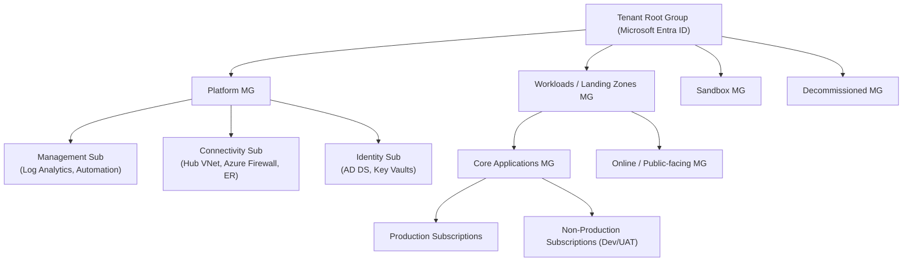
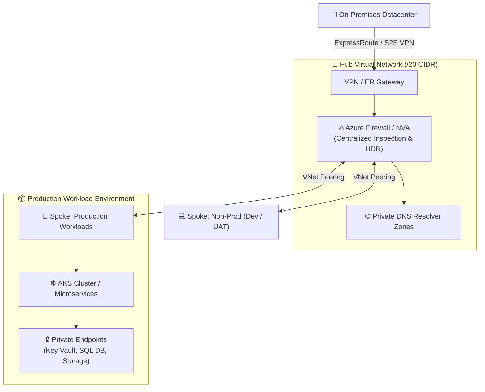

# Enterprise Azure Landing Zone & Governance Blueprint

> Aligned with the Microsoft Cloud Adoption Framework (CAF) for Enterprise-Scale Architectures.

---

## 🏛️ 1. Management Group & Subscription Topology

To support enterprise workloads, multi-tenancy, and strict compliance boundaries across Dev, UAT, and Production, the subscription hierarchy follows a structured Management Group (MG) architecture:

### Key Architectural Standards
- **Tenant Subscription Boundaries**: Strict blast-radius containment separating Platform services (Identity, Connectivity, Management) from Application Workloads.
- **Onboarding & Offboarding Lifecycle**: Standardized Terraform modules for vending subscriptions with automated RBAC bindings, budget alerts, and security baselines.
- **Policy Exemptions**: Formal exemption request process with business justification, risk assessment, and time-bound expiry tags.

---

## 🌐 2. Hub-and-Spoke Secure Networking Model

Centralized inspection, controlled egress, and zero-trust perimeter design:

### Core Network Controls
- **IP Address Management (IPAM)**: Clean, non-overlapping CIDR allocation accounting for on-premises hybrid routing and cloud scale.
- **User Defined Routes (UDRs)**: `0.0.0.0/0` default route forced through Azure Firewall for egress traffic inspection and threat intelligence filtering.
- **Private Endpoints & Private DNS**: Directing PaaS traffic (Key Vault, Storage Accounts, SQL DB) exclusively over private IPs, blocking public endpoint exposure.

---

## 🛡️ 3. Multi-Layer Enterprise Security & Governance

| Layer | Governance Control & Enforcement |
| :--- | :--- |
| **Identity Level** | Microsoft Entra ID (PIM with JIT access, MFA enforcement, RBAC via Security Groups, Service Principals with federated credentials). |
| **Networking Level** | Hub-and-Spoke isolation, NSGs with strict micro-segmentation, Azure Firewall Application & Network Rules, Web Application Firewall (WAF). |
| **Governance Level** | Azure Policy & Initiative assignments (`Require Tagging`, `Allowed Locations`, `Enforce Encryption at Rest`, `Deny Public IP on NICs`). |
| **Compute Level** | Defender for Cloud (CSPM & CWP), automatic OS vulnerability patching, disk encryption with customer-managed keys (CMK). |

---

## ⚙️ 4. Terraform Landing Zone Automation & Best Practices

All landing zone infrastructure is provisioned through modular Terraform code adhering to enterprise state security:

- **State File Security**: Stored in geo-redundant Azure Blob Storage (`Standard_GRS`), restricted via RBAC (Least Privilege), encrypted at rest with CMK, and locked using Azure Storage lease blobs.
- **Reusable Module Library**: Standardized modules for VNets, Subnets, NSGs, AKS, Storage, and Key Vaults with version tagging.
- **Pipeline Quality Gates**:
  1. `terraform fmt` & `tflint` (Static linting & syntax validation)
  2. `checkov` & `tfsec` (Security posture & compliance scanning)
  3. `infracost` (Predictive cloud cost diff on Pull Requests)
  4. Manual Approval Gates for Production deployment
  5. **Automated Drift Detection** running on a daily cron schedule to alert on out-of-band portal changes.
