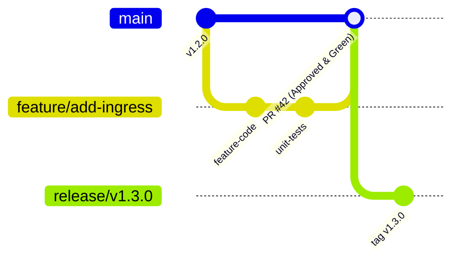
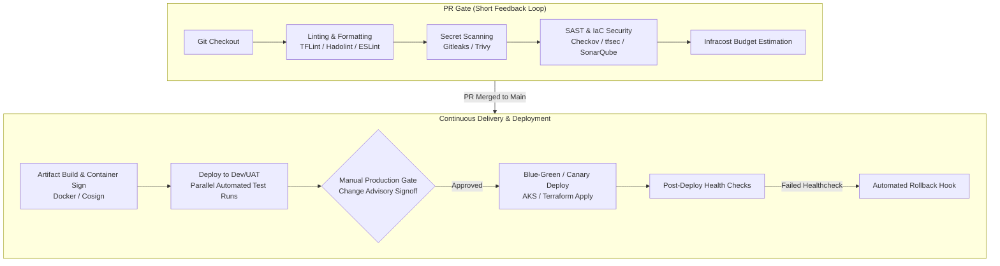

# Enterprise DevSecOps CI/CD Pipeline Standard

> Production-Grade CI/CD Pipeline Automation, Security Gates, and Branch Governance.

---

## 🌳 1. Trunk-Based Branching & Governance Policies

To ensure fast iteration, minimal merge conflicts, and zero untested code reaching production, all repositories follow a Trunk-Based Development model with strict branch policies:

### Branch Policy Protections (`main`)
- **Direct Commits Blocked**: Pull Requests (PR) mandatory for all changes.
- **Reviewer Quorum**: Minimum 2 peer approvals required, including designated **Code Owners**.
- **Build Validation**: PR must pass automated CI pipeline checks before merge is allowed.
- **Short-Lived Feature Branches**: Feature branches live < 48 hours to minimize merge drift.
- **Branch Deletion Guard**: No deletion of `main` / `release/*` branches.

---

## 🔄 2. Modular DevSecOps Pipeline Architecture

Pipelines are orchestrated using reusable YAML templates with built-in security shift-left controls:

---

## 📦 3. Standardized Pipeline Templates

1. **`validate-and-test.yml`**: Validates syntax, runs unit test suites, executes code coverage analysis.
2. **`security-scan.yml`**: Scans container images for CVEs, scans source code for credential leaks, and scans Terraform for CIS benchmark compliance.
3. **`infra-apply.yml`**: Handles state lock acquisition, targeted plans, and controlled apply steps.
4. **`automated-rollback.yml`**: Triggered automatically if synthetic health probes fail post-deployment, restoring previous state or container tags without downtime.

---

## 🔍 4. Automated Drift Detection

- **Daily Scheduled Job**: Runs outside business hours comparing the desired state (Git) against the live Azure environment.
- **Alerting & Remediation**: Automatically raises an incident ticket and notifies DevOps on Slack/Teams if unauthorized drift is detected.
