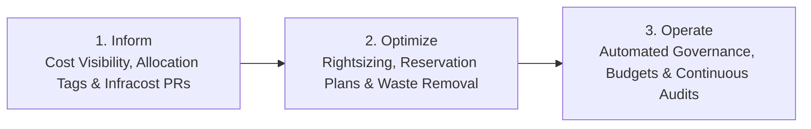

# Enterprise FinOps & Cloud Cost Optimization Strategy

> Actionable Framework for Cloud Financial Management, Resource Rightsizing, and Waste Elimination.

---

## 💰 1. Core FinOps Lifecycle

---

## 🎯 2. High-Impact Cost Optimization Tactics

| Optimization Area | Problem Identified | Remediation & Engineering Solution |
| :--- | :--- | :--- |
| **Orphaned Storage** | Unattached managed disks and orphaned snapshots from deleted VMs accumulating monthly costs. | Automated Azure Function / Logic App identifying disks with `ManagedBy == null` older than 14 days, creating snapshot backup and purging. |
| **Oversized Compute** | VMs & AKS Node pools provisioned for peak load running at < 15% average CPU/Memory. | Rightsizing instances using Azure Monitor telemetry; migrating stable workloads to B-series (burstable) or modern v5 SKU series. |
| **Non-Production VM Uptime** | Dev & UAT VMs running 24/7 generating unnecessary off-hours compute charges. | Implemented automated start/stop Runbooks using Azure Automation & Tags (`Schedule: 9to7_MonFri`), cutting non-prod compute costs by **~65%**. |
| **Commitment Discounts** | Baseline predictable workloads running on on-demand pay-as-you-go rates. | Analyzed 60-day historical consumption to purchase 1-year and 3-year Azure Reserved Instances (RIs) and Azure Savings Plans. |
| **Log Ingestion Bloat** | Log Analytics workspaces ingesting verbose debug telemetry, verbose firewall logs, and duplicate events. | Filtered high-volume diagnostic categories (e.g., IIS access logs, debug events); switched low-touch logs to Azure Data Explorer or Basic Logs tier. |
| **Backup Retention** | Over-retention of daily backups on high-tier GRS storage beyond compliance needs. | Refactored Azure Backup Vault policies: Tiered retention (Daily 7 days, Weekly 4 weeks, Monthly 12 months) and leveraged Archive tiers. |

---

## 🛡️ 3. Disaster Recovery (DR) vs Cost Efficiency

Balancing High Availability with Budget Realities:

- **Storage Redundancy**: Applied **ZRS** (Zone-Redundant Storage) for production high availability without incurring the 2x premium of multi-region **GRS** where business RTO/RPO permitted.
- **Compute Scalability**: Utilized Azure Virtual Machine Scale Sets (**VMSS**) with autoscaling metrics (CPU > 75% scale out, CPU < 25% scale in) rather than static high-capacity fleets.
- **RTO & RPO Alignment**: Tiered applications into Tier 1 (Mission-Critical: RTO < 1h, RPO < 15m with Azure Site Recovery), Tier 2 (Standard: RTO < 8h, RPO < 4h), and Tier 3 (Cold Standby / Redeploy from IaC).
