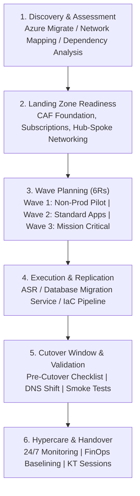

# Enterprise Cloud Migration Playbook (100+ Applications)

> End-to-End Migration Strategy for Enterprise Multi-Tier Workloads from On-Premises to Azure.

---

## 🚀 1. The 100+ Workload Migration Architecture

Enterprise migrations require a phased, repeatable strategy balancing speed, reliability, and business continuity across Dev, UAT, and Production:

---

## 📋 2. Comprehensive Migration Checklists

### A. Pre-Migration Checklist
- [ ] Network connectivity validated (ExpressRoute / VPN bandwidth, non-overlapping IP CIDR confirmed).
- [ ] Dependency mapping completed (database dependencies, external APIs, active directory bindings).
- [ ] Azure Landing Zone provisioned (Hub-Spoke VNets, NSGs, Azure Firewall rules configured).
- [ ] Target compute rightsizing completed using 30-day performance utilization counters.
- [ ] Migration rollback criteria and stakeholder communication channels established.

### B. Cutover Window Checklist
- [ ] Stop source application services to prevent data drift.
- [ ] Execute final differential database synchronization via Azure Database Migration Service.
- [ ] Trigger cutover failover in Azure Site Recovery (ASR) or containerized deployment.
- [ ] Update internal/external DNS records to point to Azure Application Gateway / Front Door.
- [ ] Execute smoke test test suites (automated synthetic health checks, database read/write validation).
- [ ] Go/No-Go decision call with application owners and business stakeholders.

### C. Post-Migration & Hypercare Checklist
- [ ] Verify Azure Monitor alerts, Log Analytics ingestion, and Application Insights traces.
- [ ] Confirm automated backup schedules (Azure Backup Vault / RPO compliance).
- [ ] Decommission temporary replication agents on source systems.
- [ ] 14-day Hypercare support window with daily operational health review.
- [ ] Handover documentation, architecture diagrams, and runbooks delivered to operations team (RACI matrix).
